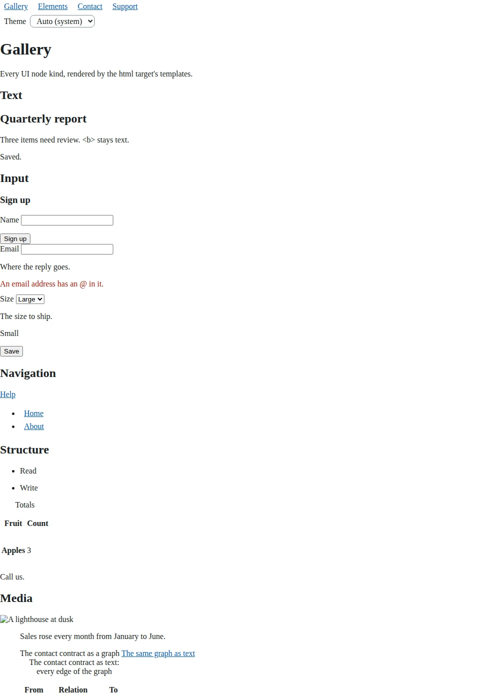
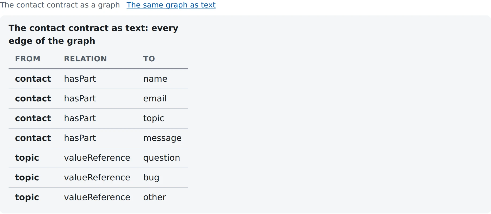
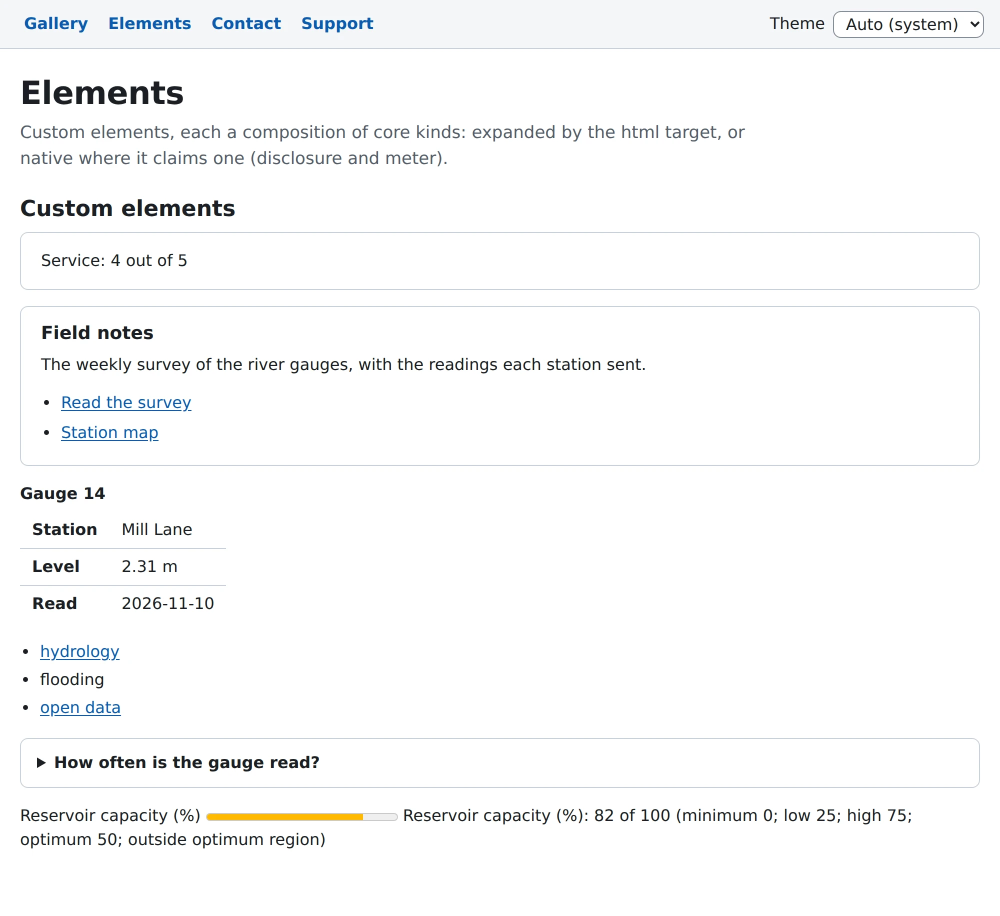
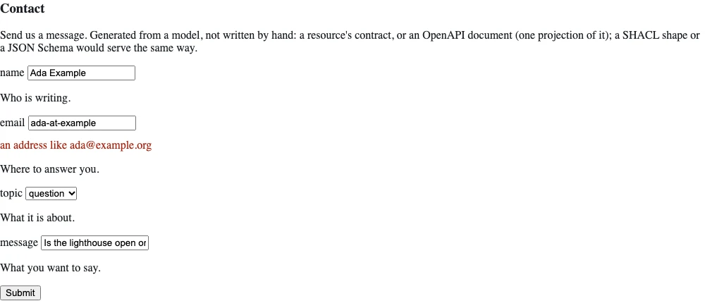
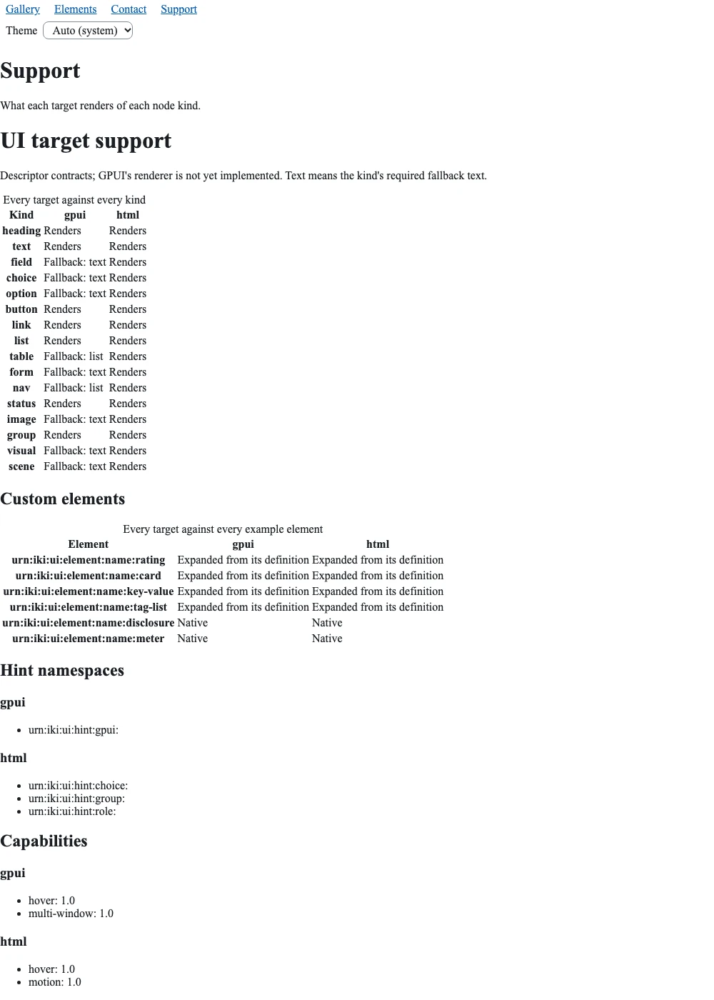
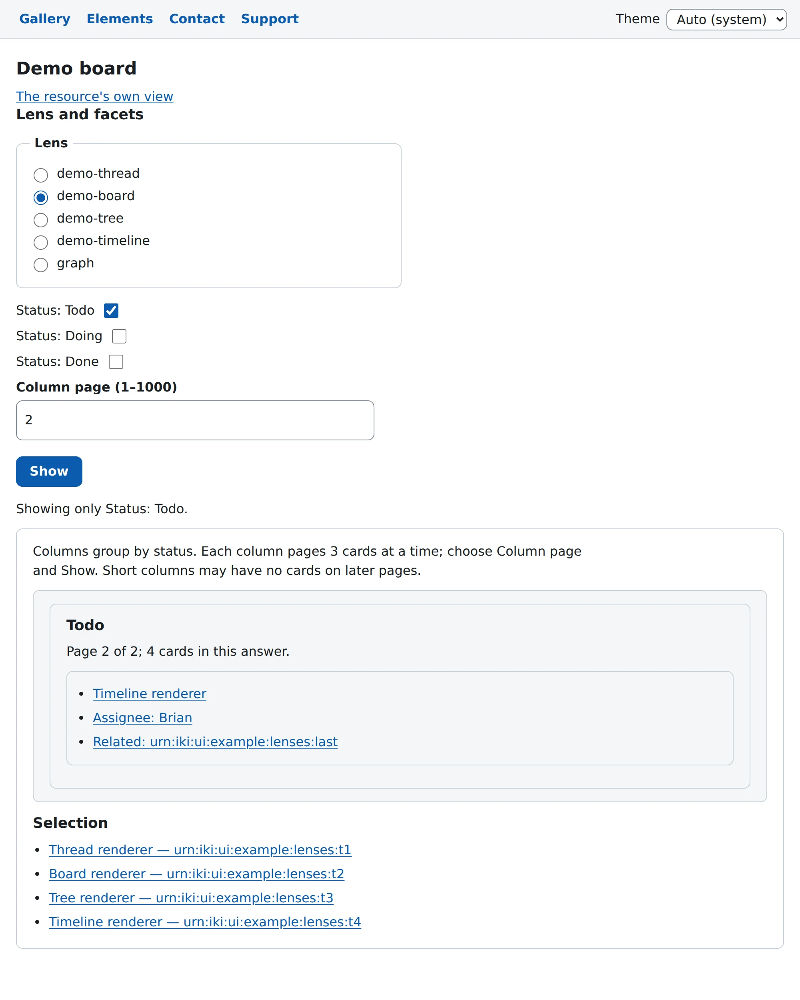

# ikigai-ui

The shared UI path for [ikigai](https://github.com/ikigai-rs) hosts, as resources. Bind one
space and every page you serve gets the same htmx, the same themes, the same refusal and focus
behavior, and the same tests.

## What it looks like

<picture>
  <source media="(prefers-color-scheme: dark)" srcset="docs/screenshots/gallery-dark.webp">
  
</picture>

The HTML gallery above is generated from the demo's fixtures (`scripts/screenshots.sh`; light or
dark follows your GitHub theme). The native GPUI windows are captured by
`scripts/gpui-screenshots.sh` on a machine with an unlocked screen, as
`docs/screenshots/gpui-*.png`. Native images are still pending a capture from such a session;
see [native capture requirements](gpui/README.md#readme-images) before running the script.
Once captured, the light and dark native gallery belongs beside the HTML gallery here.

| name | what you get |
|---|---|
| `urn:iki:ui:htmx` | htmx 2.0.4, vendored and SHA-256 pinned; the shell loads it with `integrity=` and configures it once (`allowEval:false`, `allowScriptTags:false`) |
| `urn:iki:ui:tokens.css` | one token set (gonk's names, with `--line` for component borders and `--rule` for decorative lines) in light, dark and high contrast; `auto` follows the system, `prefers-contrast: more` picks high contrast, `data-theme` overrides; every pair contrast-tested (WCAG 2.2 AA, AAA for high contrast) |
| `urn:iki:ui:base.css` | an opt-in base stylesheet for a family with no look of its own (`Pages::stylesheet("/ui/base.css")`): system type, the header, groups as cards, fields, buttons, tables, lists, figures and the disclosure, every color a token, so it follows the theme; the demo uses it, gonk keeps its own |
| `urn:iki:ui:shell.js` | the one first-party script: refusals shown as text where they happened, a 403 disables its control, one status region, focus after a swap, the theme applied before first paint, and live views refetched from the door's push stream |
| `urn:iki:ui:template:shell` | the page shell: landmarks, a skip link, the status region, the theme chooser in the header, no inline script or style |
| `urn:iki:ui:theme-chooser:{theme}` | the theme chooser, `{theme}` selected: a GET form with a "Theme" label, a native select of Auto (system), Light, Dark and High contrast, and an Apply button for a page with no script |
| `urn:iki:ui:chooser:{family}:{theme}` | what the shell puts in a family's header, for ANY family: the family's `urn:iki:ui:chooser-override:{family}:{theme}` if one is bound, else the theme chooser |
| `urn:iki:ui:form:resource:{iri}` | a `form` node generated from a MODEL, not written by hand: `{iri}`'s own contract (its Meta), one field per input its Sink reads, required or optional, typed, a choice for a closed set, its default as the value. The contract is the model; OpenAPI is one projection of it, and a SHACL shape or a JSON Schema would serve the same way |
| `urn:iki:ui:form:openapi:{doc}:operation:{op}` | the same form from an OpenAPI 3.1 document's operation, for a service that is not an ikigai resource; the same model gives the same form |
| `urn:iki:ui:view:resource:{iri}` | the view of `{iri}` (ledger #3366): the curated `urn:iki:ui:view:type:{class}` for its type when one is bound (`{iri}` in its text is the resource), else generated from what it says about itself: its contract (Meta), its data (Source as JSON, `@type` its classes, `{"@id":…}` another resource), its types' shapes at `urn:iki:ui:shape:type:{class}` (SHACL in any RDF syntax: Sourced `as=application/ld+json`, through the kernel's transreptors for Turtle and the rest, then flattened and compacted against the view's own context by the host's `urn:jsonld:flatten` and `urn:jsonld:compact`, so prefixes and form do not matter; labels, order, `table` layout; a bound shape that cannot be read so is a note in the view) and a form for each action the CALLER may take (`urn:kernel:actions`). Nested resources render through their own views, bounded by depth and nodes; past a bound or at a cycle, a link. A resource the caller may not read is withheld. `urn:iki:ui:view:generated:{iri}` is always the generated one, for a curated view to start from |
| `pages(family, base)` | your `{base}page:{name}` pages: the shell over your `{base}header` (then the theme chooser), `{base}title:{name}` and `{base}fragment:{name}`; a name with `:` in it (`item:5`) reaches them whole |
| `Pages::new(family, base)` | the same, with your own stylesheets and scripts in `<head>`, the door's push stream named for live views, and the chooser turned off with `.theme_chooser(false)`; `.lenses(true)` serves `{base}page:lens:{lens}:resource:{iri}`, a lensed view as a full page in the shell (its legend the title, its scene drawn by the renderer), which a door routes from `/lens/name/{lens}/resource/{+iri}`, the path a resource view's "Lenses" form opens |
| `urn:iki:ui:target:name:{target}` | the `html` or `gpui` descriptor: versioned capabilities, rendered kinds, fallbacks and target limits |
| `urn:iki:ui:criterion:kind:{kind}:target:{target}` | `{kind}`'s accessibility acceptance criterion on the `html` or `gpui` face (ledgers #3541, #3542), linked from the kind's descriptor: the element or role it emits, its keys and their outcomes, what a screen reader announces (Name, Role, Group: hint, error and group name after the label, State), device-settings checks (text at 200%, zoom, high contrast) and SEE checks (a test can verify them, and `probe` names how) and HEAR checks (they need assistive technology), each `blocked` by the toolkit where it cannot pass yet; a gpui criterion also says what VoiceOver, Narrator and Orca should announce once there is a tree (`announce`, ledger #3546). Turtle by default, `as=text/plain` in words; every kind. `tests/criterion.rs` verifies every html SEE check with a probe against the rendered HTML of every node of its kind on the gallery and elements screens, and reports the ones it cannot; the gpui face's probes run in the window tests (`gpui/src/native.rs`). The html wording is seeded from magentaA11y and atomica11y-skills (Apache-2.0, `NOTICE`); the gpui criteria are our own, from each desktop platform's guidance |
| `urn:iki:ui:criterion:element:{element}:target:{target}` | the same for this crate's custom elements: `card`, `key-value`, `tag-list`, `disclosure` and `meter` (`meter`'s, and `scene`'s, html criteria written from `ACCESSIBILITY.md`, which neither source covers) |
| `urn:iki:ui:shape:criterion` | the criterion vocabulary (`urn:iki:ui:criterion:term:`) and its closed SHACL shapes, Turtle; `ikigai_ui::criterion::validate` says the same in Rust |
| `urn:iki:ui:support` | every target against every kind, plus capabilities, composed from descriptors; JSON by default, `as=text/html` for the support page |
| `urn:iki:ui:face:target:{target}:screen:{screen}` | `urn:iki:ui:screen:name:{screen}` with the descriptor's fallbacks applied; model JSON by default, `as=application/ld+json` for named JSON-LD nodes |
| `urn:iki:ui:element:name:{name}` | a custom element's definition (ledger #3358): its argument contract and its expansion, a model template over core kinds and other elements; a face renders an element natively when its descriptor claims it, else expands it (bounded by depth and nodes produced, a cycle refused), else its declared `replacement`, else its `fallback` text. `rating`, `card`, `key-value`, `tag-list`, `disclosure` and `meter` are this crate's, shown at `urn:iki:ui:screen:name:elements` (the demo's `/page/elements`); `disclosure` is native on both faces (HTML `<details>`/`<summary>` from `urn:iki:ui:template:element:disclosure`, GPUI a toggle whose state is the window's), `meter` is also native on both faces (HTML `<meter>` with an associated label, GPUI a palette bar with its numeric reading beside it); the others expand on every face |
| `urn:iki:ui:hint:choice:radio` | a presentation hint on a `choice` (value `radio`, ledger #3537): a face whose descriptor claims `urn:iki:ui:hint:choice:` draws it as radio buttons, the html face a `<fieldset>` with its `<legend>` and one native radio per option (`urn:iki:ui:template:hint:choice-radio` and `:option-radio`; the arrow keys move within the group), the GPUI face a radio group (one tab stop, the arrows move the selection, the choice announced in the status line); a face that does not claim it keeps its select. The lens chooser, on a lensed view and on a resource's view, carries it |
| `urn:iki:ui:hint:role:mark` | a presentation hint on a list item or a table row (value `danger`, `asserted` or `derived`, ledger #3521): a face whose descriptor claims `urn:iki:ui:hint:role:` draws a violation in the palette's danger color with a solid danger rule, an asserted row with a solid rule and a derived one with a dashed rule (the html face a `ui-role-{role}` class on the `<li>` or `<tr>`, the GPUI face the same rules natively); the row's own text always says the same, so a face that drops the hint loses a line, never the meaning. A lens's query states it per row as `?role` |
| `urn:iki:ui:lens:report:{graph}`, `urn:iki:ui:lens:inferred:{graph}` | graphs a lens joins to its data (ledger #3521): `{graph}`'s SHACL report (`urn:shacl:validate` against the host's `urn:iki:ui:lens:shapes:{graph}`), and what OWL 2 RL derives from it and it does not assert (`urn:reason:inferred`), both read under the CALLER's capability. A lens names them in `graphs` as `urn:iki:ui:lens:report:{focus}`. The example lenses `shacl-violations` (renderer `violations`: the failing nodes as a scene, as links and as a table, each in the danger role and saying its severity, message and shape; a checkbox per severity) and `asserted-vs-derived` (renderer `split`: a legend, and every triple as a row, asserted solid, derived dashed, its last cell saying which, OWL 2 RL or PROV-O) need `urn:shacl:validate` and `urn:reason:inferred` bound beside them |
| `urn:iki:ui:scene:graph:{graph}` | an embedded 3D scene's DATUM (ledger #3514), `application/vnd.ikigai.ui.scene+json`: `{graph}`'s nodes (labels, types, positions), its edges (labels) and a camera; data, never code (no shaders, no scripts: the datum is closed). `{graph}` is read under the CALLER's capability, in its own face when that is JSON(-LD), else `as=application/ld+json` |
| `urn:iki:ui:layout:graph:{graph}` | 3D positions for `{graph}`'s nodes: a force-directed layout from a fixed seed, fitted to the unit sphere; cacheable and golden-threaded from the graph, so an unchanged graph is laid out once and an edit to it cuts the layout |
| `urn:iki:ui:shape:scene` | the scene datum's SHACL shape (Turtle); `ikigai_ui::scene::validate` says the same in Rust |
| `urn:iki:ui:scene-renderer.js` | the html face's WebGPU renderer, a first-party script like shell.js: fixed shaders, reads only the datum its `scene` names (a same-origin path), orbit/zoom/select by mouse and keyboard, the selection said in `#status`. With no WebGPU, no adapter or no script the canvas stays hidden and the scene's replacement is the scene |
| `scene` (a core kind) | `label` (its fallback text), `datum` (the scene datum's IRI) and a REQUIRED `replacement`, its accessible form (the same graph as text). The html face draws the canvas with the replacement beside it, linked from the caption; a face that does not claim `scene` (gpui in phase 1, or an html descriptor a host overrides) shows the replacement in its place, else the label. The gallery's is the demo's contact contract as triples, `urn:iki:ui:example:graph:contact`. The s-expression face spells a replacement `:replacement (…)` |
| `urn:iki:ui:view:lens:{lens}:resource:{iri}` with a `construct` lens | a lens whose renderer is `construct` (ledger #3520) has no template: its read-only SPARQL CONSTRUCT builds the UI model as RDF in the model's own vocabulary (each node `a urn:iki:ui:kind:name:{kind}`, its properties `urn:iki:ui:property:name:{p}`, children `…:child` placed by an integer `…:order`), framed to the model's JSON by the model's context and validated and bounded exactly as any screen is; an IRI `href` links through the home mapping; past its bound (in nodes) it shows nothing and says so. `contact-dashboard` is the example: a table of counts by type and a line on the required fields |
| `artifacts(&[Artifact], dir)` | your own artifacts, with the same two deliveries: compiled in, or a file under your directory prefix |

The gallery's scene as a reader without WebGPU gets it, its replacement (the canvas is not
pictured: headless Chromium's screenshots do not carry WebGPU pixels):

<picture>
  <source media="(prefers-color-scheme: dark)" srcset="docs/screenshots/scene-dark.webp">
  
</picture>

```rust
let kernel = Kernel::new(Arc::new(Fallback::new(vec![
    Arc::new(ikigai_ui::space()),                      // the artifacts, palettes, tokens.css
    Arc::new(ikigai_ui::pages("app", "urn:app:")?),    // urn:app:page:{name}
    Arc::new(my_app),                                  // urn:app:header, :title:{name}, :fragment:{name}
    // Optional: override any artifact from a directory, golden-threaded.
    Arc::new(EndpointSpace::new().bind(
        UriTemplate::parse("urn:iki:ui:dir:{path}")?,
        ikigai_fs::FileEndpoint::new("ui/").cacheable(),
    )),
])));
// Door routes: /ui/{…} → urn:iki:ui:{…} (one route-table prefix entry, D10) and
// /app/page/{name} → urn:app:page:{name} (the mechanical rule).
```

**Compiled in, or from a directory, under the same names.** Every artifact is compiled in. Bind
a directory at `urn:iki:ui:dir:` and a file there (`shell.html`, `shell.js`, `tokens.template.css`,
`htmx.min.js`) replaces that one artifact, and a write to it recomputes every page over it. A
directory cannot add a name and nothing here serves a header or a CSP: those belong to the door.

**The page splices what the host says, never what the request says.** A page's fragment is
fixed by its own name and family, so a request argument cannot point the shell at another
resource. The page name is bounded before anything is read (RFC 3986's unreserved characters
and `:`; no `/ ? # %`), so it picks among your own `{base}fragment:…` names and nothing else.

**A theme chooser on every page.** The shell puts the chooser in every page's `<header>`, after
your `{base}header`, with the page's theme selected, so a family gets it without writing it (the
same chooser the tutorial books have: auto, light, dark, high contrast, in words). With the shell
script, a change applies at once and the Apply button is hidden; with no script, Apply reloads
the page with `theme=`, which the page renders. To put it somewhere else, turn the shell's off
(`Pages::new(…).theme_chooser(false)`) and splice `urn:iki:ui:theme-chooser:{theme}` where you
want it; to have none, just turn it off. One chooser per page (its select is `#ui-theme`).

**A page composed over the shell directly** (`urn:iki:fn:compose src=<urn:iki:ui:template:shell>
family=… name=…`, say from a names file) gets the chooser too, with nothing to bind: the shell
reads `urn:iki:ui:chooser:{family}:{theme}`, and this crate's space answers it for every family.
Declare `theme` as an input of the name, with a default, so the chooser's no-script Apply works:

```text
urn:quakes:page = source urn:iki:fn:compose src=<urn:iki:ui:template:shell> family=quakes name=home
  input theme default=auto one-of="auto" one-of="light" one-of="dark" one-of="high-contrast"
```

A bare request renders `auto`, Apply's `?theme=dark` renders dark, and a value that is not a theme
is refused. Do not write `theme=auto` on the binding's own line: that fixes the argument, and a
caller who gives a fixed argument is refused, so Apply is too (with script, the choice still
applies at once, since it never reaches the server).

To turn the chooser off, bind the family's override to nothing, for every theme:

```text
urn:iki:ui:chooser-override:quakes:{theme} = source urn:file:empty.html
```

Bind the override to your own markup to replace the chooser there instead. A page that fixes its
theme only needs that theme's override, but with a `theme` input, an override for `auto` alone
brings the chooser back at `?theme=dark`. Bind the override, not
`urn:iki:ui:chooser:{family}:{theme}` itself: a host resolves a name in the first space that binds
it, and this crate's space usually comes first (a names layer comes last), so a binding of the
shell's own name after it is never reached. `Pages::theme_chooser(false)` binds the same override,
so it holds wherever the host puts the family.

A viewer's choice is kept in this browser only: `localStorage` under `ikigai-ui:theme` (choosing
auto clears it), applied before first paint over the server's `auto`. It is never sent to the
server, except as `theme=` in the URL when the form is submitted with no script. A GET form's
`theme=` replaces the page's own query string, so a page whose query matters wants the script,
or its own chooser.

**Live views.** Name the push stream on the family (`Pages::new(…).push("/_ikigai/push")`, the
cli door's path), and a view that says what it shows refetches itself on a cut:

```html
<div id="board" hx-get="/app/fragment/board" hx-trigger="ikigai:cut" hx-swap="outerHTML" data-ui-push="">…</div>
```

`data-ui-push` holds the paths the view shows (empty: its own `hx-get`). The shell script opens
one `EventSource` for every such view on the page, sends `ikigai:cut` to the views a cut's
`paths` name (all of them on a `resync`), keeps the refetch quiet and keeps focus. A cut that
lands while a view's own request is in flight is sent again once it settles (tracked on the
view, so an `hx-indicator` elsewhere does not hide it); a view that swaps `outerHTML` wants an
`id`, which is how its replacement is found. When a swap changes the declared paths the stream
is reopened, and every view is refetched once the new stream is ready, since a cut in the gap
was heard by nobody. A stream the door refuses (a `400` past its subscription bound) is said
once in `#status`. The door grants `urn:cap:kernel:listen` for the stream to answer.

## Target contracts and screen faces

The descriptors are data in `assets/target/html.json` and `assets/target/gpui.json`. A host
can override them through `urn:iki:ui:dir:target/html.json` and `…:target/gpui.json`, with the
same file dependency and refusal rules as other artifacts. Writes through the kernel cut the
cached descriptor, support matrix and every face that read it. Files cannot add a target;
an unknown target answers `NotFound`.

Each descriptor has named `name`, `capabilities`, `renders`, `fallback` and `limits`
fields. Unknown fields are refused with a message naming the field, including inside
capabilities and limits. `capabilities` is a list of unique feature names with explicit,
nonempty versions, for example `{"name":"hover","version":"1.0"}`. HTML advertises hover
and motion; the future GPUI contract advertises hover and multi-window. Versions are
identifiers here; elements and hints will declare their `requires` in a later phase, which
will define requirement matching. Advertising a feature does not install its renderer.

The face applies this fallback ladder to every node:

1. Render natively when the descriptor's `renders` claims the kind and its limits and child
   constraints permit it.
2. Expand into core kinds. A custom element (`urn:{ns}:ui:element:name:{name}`) the descriptor
   does not claim in `elements` is replaced by its definition's expansion, its arguments and
   children spliced in, recursively and bounded (`ikigai_ui::element`, ledger #3358); the result walks
   this same ladder. An element with no readable definition goes on to step 3.
3. Use the node's optional `replacement` subtree, otherwise the descriptor's
   `fallback` kind. A replacement subtree walks the same ladder. Descriptor chains try
   native rendering at each destination, then its expansion, then its next replacement.
4. Show the original kind's required fallback text (`alt` for image, `caption` for table,
   and so on). Descriptor destination `text` requests that same text directly.

Node `fallback` is refused. The shape-level `urn:iki:ui:property:name:fallback`
annotation still identifies the property containing a kind's fallback text; a node's
replacement subtree uses `urn:iki:ui:property:name:replacement`.

Every nonnative kind needs a descriptor fallback decision; native kinds may also declare
one for when a limit or projected child constraint prevents native rendering. `text` must
be rendered and cannot have a descriptor replacement. All descriptor chains must terminate,
even those beginning at native kinds. Projection copies destination-compatible properties,
maps the source's fallback text to the destination's fallback property and projects children
when the destination takes them. Faces remove replacement metadata after making their choice,
so a client walks only renderable nodes. An unsupported kind is never a rendering error;
a malformed screen or descriptor remains an input/configuration error.

A node's replacement is another validated node, not raw markup. The model's size/depth bounds,
closed kind/property validation, safe URL checks, Turtle shapes and named JSON-LD paths
include replacement subtrees. For example:

```json
{
  "kind": "image",
  "properties": {"alt": "Revenue chart", "src": "/revenue.png"},
  "replacement": {"kind": "text", "properties": {"content": "Revenue increased 10%."}}
}
```

The HTML contract covers every current kind for the HTMX and Web Components target, with a
table bound of 1000 rows and 100 columns. Rows are the table's group children; columns count
each row's children. Larger tables use caption text. GPUI currently keeps heading, text,
button, link, list, status and group; table and nav become lists, while field, choice, option, form,
image, visual and scene use fallback text (a scene's replacement first, ledger #3514); html
renders scene natively, its WebGPU canvas with the replacement beside it. This is the contract for a future GPUI renderer; the
renderer itself is not part of this phase. The gallery's HTML face is unchanged, and its
GPUI face differs exactly at those descriptor decisions. The JSON and HTML support matrix
includes versioned capabilities and limits as well as kinds.

**Scope limitation:** the face is the target's entry point and no target argument is passed
to a screen, example, or other downstream endpoint. It reads both the descriptor and screen
in the caller's existing resolution scope. An endpoint can call `Invocation::confine`, but
that removes root resolution and would hide host screens and descriptor directory overrides.
Only the host's `Kernel::issue_in` can inject a corridor while keeping the root. Consequently
this phase does **not** install a target resolution corridor; it preserves the caller's
scope without inventing a root bypass. `tests/target.rs` reproduces that kernel limitation.
A host needing a structural corridor must arrange it at the kernel boundary.

## A screen is a space (ledger #3361)

A screen composes references and spaces; the face composes them away before the descriptor
projects.

- **Settings** are names, `urn:iki:ui:setting:name:{name}` (`target`, `theme`, `locale`,
  `density`, `viewer`), answered by the space the screen runs in. The library's space answers
  each with its default; a host builds a named screen space (`setting::screen_space`) and
  injects it ahead of the root with `Kernel::issue_in` (`setting::scope`).
  `urn:iki:ui:face:screen:{screen}` reads its target from `setting:name:target` there;
  `urn:iki:ui:face:target:{target}:screen:{screen}` stays the entry point that names one. Each
  screen space is its own cache partition, and every answer stays keyed on the capability.
- **A `reference`** (`resource`, `fallback`) names a resource. The face reads it under the
  CALLER's capability; one the caller may not read is withheld: its fallback text renders, and
  the value is in no byte of the face and no cache entry readable under that grant.
- **A `region`** (`label`, `allow`, `scopes`) is a group whose children compose in a narrowed
  space: `Invocation::confine` to the names `allow` lists and the screen's settings, read under
  the caller's capability attenuated to `scopes`. A reference, an element definition or what an
  element's expansion reads outside it is `Unresolved`, and the face refuses.
- **A write-only field** names its own `resource`: the face makes it a form that sinks to that
  resource (input `password` by default), and it holds no `value`, so a password or a card
  number is never read back into the screen.

`reference` and `region` are structural nodes, not kinds: their shapes are
`urn:iki:ui:structure:name:{name}`, their examples `urn:iki:ui:example:structure:{name}`, and the
JSON-LD context names them. `tests/space.rs` and `tests/reference.rs` hold the behaviour, and
`tests/model.rs` holds the shapes and the validator to agreement. The demo's contact screen
references `urn:iki:uidemo:inbox`, which the door's grant may not read: every visitor sees its
withheld rung.

## The demo

```sh
cargo run -p ikigai-ui-demo            # http://127.0.0.1:8080/
cargo run -p ikigai-ui-demo -- 127.0.0.1:9000
```

One binary (`demo/`, the workspace member `ikigai-ui-demo`, never published), one kernel and
one ikigai-web door. It serves four pages in the shared shell:

- `/` or `/page/gallery`: the gallery screen, every node kind rendered by the html target.
- `/page/elements`: the custom elements (`rating`, `card`, `key-value`, `tag-list`, each
  expanded into core kinds by the html target, `disclosure`, native as `<details>`, and `meter`, a labeled reservoir reading
  native as `<meter>` with value text; the GPUI face draws a palette bar and the same text).

  <picture>
    <source media="(prefers-color-scheme: dark)" srcset="docs/screenshots/elements-dark.webp">
    
  </picture>

- `/page/contact`: a contact form. **The form is a client generated from the service's
  model, not written by hand.**

  <picture>
    <source media="(prefers-color-scheme: dark)" srcset="docs/screenshots/contact-refusal-dark.webp">
    
  </picture>

  The model is the contact service's own contract (the
  one its OpenAPI description is projected from). `urn:iki:ui:screen:name:contact` is an alias
  for `urn:iki:ui:form:resource:urn:iki:uidemo:contact`, and the html target renders the
  generated node. The same generation works from an OpenAPI document
  (`urn:iki:ui:form:openapi:{doc}:operation:{op}`) or other models. Submitting the form calls
  the Sink that contract describes. That Sink takes `name`, `email`, `topic` (one of
  `question`, `feedback`, `support`) and `message`. They arrive as an argument envelope in the
  POST body. The Sink validates them, refuses a bad one with `InvalidArgument` naming the
  field (the shell lands the refusal on it), and stores the message at
  `urn:iki:uidemo:submission:id:{id}`. `urn:iki:uidemo:submission` lists the stored ones. Both
  require `urn:cap:uidemo:submission:read`, which the door does not grant.
- `/page/support`: the support matrix, what each target renders of each node kind.

  <picture>
    <source media="(prefers-color-scheme: dark)" srcset="docs/screenshots/support-dark.webp">
    
  </picture>

There is no sign-in yet: the door grants every request a write to the contact service and
nothing else. Sign-in comes later (#2169). The submissions live in memory and are gone
when the process stops. `demo/tests/door.rs` drives the door end to end.

## Lenses

A lens pairs a read-only SPARQL query with a named renderer template. The templates
are JSON data, expanded into ordinary core nodes; HTML and GPUI use the same screen,
radio lens chooser, linked selection, and checkbox facets. Queries still run under
the caller's capability and the store's time and answer budgets. A denied graph is
reported as withheld in words.

A vocabulary lens can declare gestures in its JSON definition:

```json
"actions": {
  "extend": {"graph": "urn:example:vocabulary"},
  "connect": {"graph": "urn:example:vocabulary"}
}
```

`urn:iki:ui:lens:name:{lens}:action:extend` and `:action:connect` are data on
Source and named Sinks on submission. The surrounding screen offers a linked
selection, links to select rendered terms, editable term fields (including terms
from another vocabulary), and forms generated through
`urn:iki:ui:form:resource:{action}`. `selected=` and `target=` pre-fill those forms.
Extend adds `target rdfs:subClassOf selected` and types the new class; connect adds
`selected relation target`, choosing `rdfs:subClassOf`, `owl:equivalentClass`, or
SKOS `exactMatch` / `closeMatch`. No renderer executes a gesture.

Forms appear only when the caller's `urn:kernel:actions` offers
`urn:iki:store:graph-update` and the caller holds
`urn:cap:store:write:graph:<graph>`. Submission checks again. The lens fixes the
graph; form inputs cannot override it. Extend verifies the selected class through
`urn:iki:store:graph-ask`. If `urn:iki:ui:lens:shapes:{graph}` exists, the proposed
complete graph is checked through `urn:shacl:validate` before writing. These reads
need the graph's read grant too. SHACL is a pre-flight, not an atomic transaction
with other writers. The store cuts the graph's thread on success, refreshing lenses
that read it. Refusals remain at the form on both faces.

The operations composition is
`urn:iki:ui:view:lens:operations:resource:{personal-iri}`, also available through
`/lens/name/operations/resource/{personal-iri}`. Its ordinary text field accepts a
personal dropped set, for example:

```json
[{"iri":"urn:person:alice"},
 {"value":"2","datatype":"http://www.w3.org/2001/XMLSchema#integer"}]
```

The selection is request-local, never shared mutable state. Resource types are
read under the caller's capability (JSON-LD or the host's RDF/SPARQL reader);
literals default to `xsd:string`. The capability-scoped manifold ranks matching
Sink operations. Each operation uses its generated form, pre-filled by input
class, with editable values. Submission goes through
`urn:iki:ui:lens:operation:{operation-iri}`, which rechecks availability and calls
`urn:kernel:validate` before invoking the target under the same capability.
Selections are limited to 32 values, and the first 32 fitting forms are shown;
limits and withheld reads are said in words. Template operations that still need
IRI bindings are omitted. The kernel validation argument format cannot escape
ampersands or newlines, so those submitted values receive an explicit refusal.

The four structured examples are attached to `urn:iki:ui:example:graph:lenses` by
`lens::examples()`, which the demo installs. Open, for example,
`http://127.0.0.1:8080/lens/name/demo-board/resource/urn%3Aiki%3Aui%3Aexample%3Agraph%3Alenses`.
The chooser opens the other examples. On macOS, open the same screen natively with:

```sh
cargo run -p ikigai-ui-gpui --bin ikigai-ui-demo-native -- 127.0.0.1:8080 light \
  lens:demo-board:resource:urn:iki:ui:example:graph:lenses
```

| Template | Projected columns | Behavior past the display bound |
| --- | --- | --- |
| `thread` | `item`, `label`, optional `replyTo`, `participant`, `participantName`, `time` | Each long thread keeps its root and first and last replies, ordered by time, with a reply count. Participants remain a separate list. |
| `board` | `item`, `label`, `status`, `assignee`, `assigneeName`, `related` | Status columns page independently within their own rows, using the same one-based **Column page** control. Each reports its page count; short columns can be empty on later pages. |
| `tree` | `item`, `label`, optional `broader` | Counts unique descendants in the answer. Stops after the display bound or 16 levels, says where it stopped, and keeps links in Selection. Cycles are disclosed. Map SKOS broader/narrower or `rdfs:subClassOf` onto `broader` in the query. |
| `timeline` | `item`, `label`, `time` | Orders RFC 3339 instants, normalizes day groups to UTC, and shows the first bounded rows per day. Missing or invalid dates go under Undated. |

These renderers read an answer window of at most 1000 rows (plus one to detect
more); the display bound applies inside that window. Counts and first/last replies
describe the window, not an unseen dataset. An overflow notice says when the window
is incomplete. Explicit query LIMITs and stricter store budgets still apply. Every
result item remains in the linked Selection list through the home mapping. Narrow
large answers with queries or facets. Board paging is a presentation parameter,
not SPARQL text, and preserves selected facets.

The bounded template operations are documented in [`lens`](src/lens.rs): grouped
repeats, distinct values, ordered UTC day groups, and an identity/parent hierarchy.
`urn:iki:ui:hint:group:columns` asks a face to wrap a group's children as columns;
a face without that hint keeps their stacked reading order. GET navigation forms
work with or without browser script and navigate through the native snapshot worker
in GPUI. Renderer assets, example queries, and the demo fixture live in
[`assets/renderer`](assets/renderer) and [`assets/lens`](assets/lens).



## The test kit

`ikigai-ui = { version = "0.5", features = ["testkit"] }` as a dev-dependency gives a UI repo:

- `snapshot`: pages held to files in the repo (written once, never re-blessed by a switch);
  `snapshot::assert_snapshots` checks every page, writes all missing files, then fails once
  listing every new, changed, or unreadable snapshot;
- `vectors`: FND-H's escaping and link vectors, ikigai-fn's file verbatim, to run any escaper against;
- `contrast`: the floor for every palette, through ikigai-a11y;
- `lint`: no hex color outside the palette tables, every `var(--x)` defined;
- `site`: rendered pages written as a static site, for axe.

And axe as a CI step:

```yaml
  axe:
    uses: ikigai-rs/ikigai-ui/.github/workflows/axe.yml@main
    with:
      prepare: cargo run --example axe_site -- target/axe-site
      site: target/axe-site
```

It serves the site with the door default CSP and fails on any WCAG 2.2 A/AA violation, page
error or console error, in light, dark and more-contrast media.

## Decisions

The UI conventions record (D7, D12, D13, D14, D17, D18) is the design; this crate is its shared
path. Migrating the existing apps onto it comes after the demo app and book.

Two of those decisions stand as amended on 2026-11-01 (ledger #2133, carried out in #2832):

- **D13, one status region.** `#status` is the page's only live region. A refusal note beside its
  control is plain text with no role; the control points at it with `aria-describedby` (removed
  when the note goes), and `#status` says the same sentence politely, naming the control
  ("Load details: not found"). `role="alert"` is kept for a failure with no control to sit
  beside. Quiet elements and live views say nothing.
- **D12, the 3:1 floor on component borders only.** `--line` is the border that identifies a
  control (an input, a button) and is held to SC 1.4.11's 3:1. `--rule` is a decorative line (a
  table rule, a section divider), which SC 1.4.11 exempts; it is held to a stated 1.3:1 so no
  palette can make it vanish, and light keeps gonk's `#c9d1d9`. High contrast holds both to 7:1.
- **D12, a palette is data, read as a table.** `urn:iki:ui:palette:{name}` is a resource a host
  may rebind, so it is never spliced as text: `palette::Table::parse` reads it (every token of
  `TOKENS` once, each value `#rrggbb`, nothing else) and holds it to the floor (`PAIRS`) before
  either face draws with it. `tokens.css` is written from the parsed colors, and a palette that
  carries `}` or `;`, a value that is not a color or a pair below its floor refuses the stylesheet,
  naming why (ledger #3529). The native face reads the same table.

## License

MIT OR Apache-2.0. htmx is 0BSD (`vendor/htmx-2.0.4.LICENSE`).
